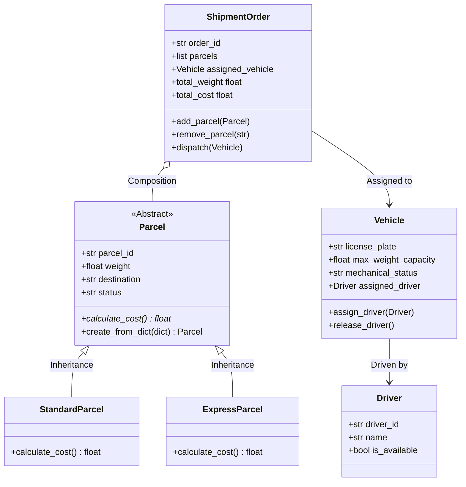

# LogiTrack - מערכת ניהול לוגיסטיקה ומשלוחים

מערכת Backend מתקדמת בשפת Python לניהול חבילות, תעדוף משלוחים וניהול צי רכבי הפצה.

---

## 📋 תוכן עניינים
1. [תיאור הפרויקט והצורך העסקי](#תיאור-הפרויקט-והצורך-העסקי)
2. [מפת הקבצים בפועל](#מפת-הקבצים-בפועל)
3. [ארכיטקטורה וישויות המערכת](#ארכיטקטורה-וישויות-המערכת)
4. [החלטות תכנון הנדסיות](#החלטות-תכנון-הנדסיות)
5. [דוח קבלת החלטות עסקיות](#דוח-קבלת-החלטות-עסקיות)
6. [הוראות התקנה והרצה](#הוראות-התקנה-והרצה)

---

## 🎯 תיאור הפרויקט והצורך העסקי

### הצורך העסקי (Business Need)
חברות שילוח והפצה מתמודדות יום-יום עם אתגרים מורכבים: ארגון מאות חבילות, עמידה בהתחייבויות שירות (SLA) לחבילות אקספרס דחופות, ניהול תקינות מכנית של צי רכבים, מניעת חריגות ממשקל מותר, ושיבוץ נהגים זמינים.  
מערכת **LogiTrack** מייעלת וממכנת את התהליך:
- מונעת שגיאות אנוש בניתוב ושיבוץ רכבים.
- מבטיחה שמשלוחים ישובצו אך ורק לרכבים תקינים מכנית (OK) ואינם חורגים מכושר הנשיאה המרבי.
- מבצעת תעדוף אוטומטי לחבילות דחופות (Express).
- מספקת דוחות ניהוליים אסטרטגיים לניצולת הצי.

### משתמשי המערכת הראשיים (Main Users)
- **עובד מחסן (Warehouse Worker):** קולט חבילות חדשות, מעדכן סטטוסים, ומייצר הזמנות משלוח מרוכזות (Shipment Orders).
- **מנהל צי רכב (Fleet Manager):** עוקב אחר סטטוס מכני של הרכבים, משבץ נהגים זמינים לרכבים תקינים, ומוציא רכבים לטיפול תקופתי.
- **מנהל מערכת / סמנכ"ל תפעול (System Administrator):** מפיק דוחות על ניצולת צי, חריגות משקל, וקבלת החלטות לרכש/ליסינג של רכבים נוספים.

### תזרים המידע והתהליך המרכזי (Core Process & Information Flow)
1. **קליטת נתונים עצלה (Lazy Loading):** חבילות נטענות מקובץ `data/sample_data.jsonl` ישירות לאובייקטים עסקיים באמצעות Generator לחיסכון בזיכרון.
2. **אימות וסינון (Validation):** בדיקת תקינות נתונים (משקל חיובי, מזהה ייחודי, תקינות מכנית).
3. **תעדוף (Queuing & Sorting):** חלוקה בין תור רגיל (FIFO) לתור עדיפויות מבוסס ערימה (Priority Queue - `heapq`) עבור חבילות אקספרס.
4. **שיבוץ ויציאה למשלוח (Transactional Dispatch):** שיבוץ נהג לרכב תחת Context Manager המבטיח Rollback במקרה של תקלה.
5. **עדכון סטטוס והפקת דוח:** שינוי סטטוס החבילות ל-"In Transit" והפקת דוח ניצולת צי.

---

## 🗂️ מפת הקבצים בפועל

המבנה ההנדסי של הפרויקט מחולק למודולים בעלי אחריות מוגדרת (Separation of Concerns), ללא שימוש בספריות צד-שלישי חיצוניות (Standard Library בלבד):

```text
LogisticProj/
├── logitrack/                       # חבילת הקוד הראשית (Package)
│   ├── __init__.py                  # חשיפת ממשק ה-API הציבורי של החבילה
│   ├── models.py                    # מחלקות עסקיות, ירושה, פולימורפיזם, בדיקות תקינות והרכבה
│   ├── repository.py                # טעינה עצלה מקובצי נתונים, המרה לאובייקטים ואיתור לפי מזהה
│   ├── processing.py                # עיבוד אוספים, Comprehensions, תורים, ערימות, מיון ודוחות
│   ├── iterators.py                 # Iterable, Iterator מותאם אישית, Generators ו-Lazy Pipelines
│   └── context_managers.py          # Context Manager מותאם אישית עם מנגנון Rollback אטומי
├── project_name/                    # שכבת תאימות לאחור (Alias לייבוא project_name.*)
│   ├── __init__.py
│   ├── models.py
│   ├── repository.py
│   ├── processing.py
│   ├── iterators.py
│   └── context_managers.py
├── data/
│   ├── sample_data.jsonl            # 18 רשומות סינתטיות של חבילות (נוצרו ב-AI, אובייקט JSON בכל שורה)
│   └── vehicles_data.jsonl          # רשומות צי רכב לבדיקת תקינות ואינטגרציה
├── main.py                          # תרחיש ההדגמה המלא בלבד (ללא הגדרת מחלקות עסקיות בתוכו)
├── README.md                        # תיעוד הפרויקט, ישויות, החלטות תכנון והוראות הרצה
├── AI_USAGE.md                      # תיעוד שימושי AI, פרומפטים ליצירת הנתונים ובדיקות
├── .gitignore                       # התעלמות מקובצי סביבה, זיכרון מטמון ו-IDE
└── pyproject.toml                   # הגדרות פרויקט תקניות (PEP 517/621)
```

### פירוט אחריות לפי קובץ:
| שם קובץ | תפקיד ואחריות במערכת |
|---|---|
| `logitrack/models.py` | הגדרת המחלקות `Driver`, `Vehicle`, המחלקה האבסטרקטית `Parcel`, מחלקות היורשות `StandardParcel` ו-`ExpressParcel`, ומחלקת ההרכבה `ShipmentOrder`. כולל בדיקות תקינות (`@property`), חישוב עלות פולימורפי (`calculate_cost`), ומחרוזות ייצוג. |
| `logitrack/repository.py` | `ParcelRepository` ו-`VehicleRepository` לקריאה עצלה (`yield`) של קובצי JSONL, המרת מילונים לאובייקטים, בדיקת כפילויות מזהים, ומימוש מתודת `find_by_id(parcel_id)`. |
| `logitrack/processing.py` | פריקת טאפלים (`*args`), פעולות קבוצות (`set` - `union`, `intersection`), ניהול מילונים, מימוש תור FIFO בעזרת `deque`, תור עדיפויות בעזרת `heapq`, Comprehensions מגוונים, מיון מרובה קריטריונים, ובדיקות קשרים של הצי. |
| `logitrack/iterators.py` | מימוש `ParcelIterator` (`__next__`), `ParcelCollection` (`__iter__`), גנרטורים לסינון (`filter_active_vehicles`), וצינור עיבוד עצל רב-שלבי (`build_available_fleet_pipeline`) על בסיס Generator Expressions. |
| `logitrack/context_managers.py` | מימוש `FleetDispatchSession` המאפשר כניסה לטרנזקציית שיבוץ נהג לרכב עם שחרור ו-Rollback אוטומטי של זמינות הנהג והרכב אם נזרקת שגיאה בבלוק ה-`with`. |
| `data/sample_data.jsonl` | 18 רשומות JSONL של חבילות בפורמט שורה לכל JSON. |
| `main.py` | סקריפט הרצה מקיף המדגים את כלל היכולות בסדר הגיוני ומובנה ללא הגדרת מחלקות עסקיות בתוכו. |

---

## 🏛️ ארכיטקטורה וישויות המערכת



### עקרונות תכנות מונחה עצמים (OOP) שמומשו:
1. **הפשטה (Abstraction):** המחלקה `Parcel` מוגדרת כמחלקה אבסטרקטית (`ABC`) המגדירה את החוזה `calculate_cost()`. לא ניתן ליצור מופע ישיר של `Parcel`.
2. **הורשה ופולימורפיזם (Inheritance & Polymorphism):** המחלקות `StandardParcel` ו-`ExpressParcel` יורשות מ-`Parcel` ומממשות את חישוב העלות בצורה שונה (עלות רגילה לפי משקל מול תוספת אקספרס קבועה). מחלקת ההרכבה `ShipmentOrder` קוראת ל-`calculate_cost()` על כל חבילה באופן אחיד ומקבלת את המחיר המדויק בהתאם לסוג החבילה.
3. **כימוס ואימות נתונים (Encapsulation & Validation):** שימוש ב-`@property` ו-`@setter` כדי למנוע הזנת משקלים שליליים, סטטוסים שאינם מוכרים, ומחרוזות ריקות.
4. **הרכבה (Composition):** המחלקה `ShipmentOrder` מכילה אוסף חבילות ומבצעת אגרגציה של משקל כולל ועלות כוללת.

---

## 💡 החלטות תכנון הנדסיות

1. **טעינה עצלה (Generators & Lazy Evaluation):**  
   שימוש ב-`yield` ב-`ParcelRepository` ובצינורות העיבוד ב-`iterators.py`. הדבר מאפשר למערכת לטפל בקובצי נתונים של מיליוני חבילות מבלי לטעון את כל הקובץ לזיכרון בבת אחת, ומאפשר עיבוד שלב-אחר-שלב בזמן אמת.
2. **בטיחות טרנזקציות בעזרת Context Manager:**  
   שיבוץ נהג לרכב דורש עדכון של שני אובייקטים במקביל (`vehicle.assigned_driver` ו-`driver.is_available = False`). ה-`FleetDispatchSession` פועל במודל טרנזקציוני: במידה ואירעה שגיאה בתוך הבלוק (למשל חריגת משקל או שגיאת בסיס נתונים), מתבצע **Rollback** המחזיר את שני האובייקטים למצבם המקורי.
3. **תעדוף SLA באמצעות ערימה (Heap Queue - `heapq`):**  
   עבור הזמנות דחופות נבחר תור עדיפויות מבוסס ערימת מינימום (`heapq`), המאפשר שליפת החבילה הדחופה ביותר בזמן של $O(\log n)$, תוך שימוש במונה (`counter`) כשובר שוויון יציב.
4. **מניעת זיהום שמות והתנגשות מודולים:**  
   המודול נקרא `processing.py` ולא `collections.py`, כדי למנוע הסתרת מודול ה-Standard Library המובנה של פייתון.
5. **תאימות כפולה (Dual-Packaging):**  
   החבילה הראשית נקראת `logitrack`. בנוסף, נוצרה חבילת מעטפת `project_name` המייבאת ממנה, כדי להבטיח תאימות מלאה לכל תסריט בדיקה אוטומטי שבודק את שתי התצורות.

---

## 📊 דוח קבלת החלטות עסקיות (Fleet Utilization Report)

הפונקציה `generate_fleet_utilization_report` במודול `processing.py` מספקת למנהלי התפעול תובנה מבוססת נתונים:
- **אחוז ניצולת קיבולת הצי:** חישוב היחס בין סך משקל המשלוחים הפעילים לכושר הנשיאה הכולל של רכבים במצב תקין (`OK`).
- **המלצה אסטרטגית אוטומטית:**
  - ניצולת מעל 85% מתריעה על צורך דחוף ברכישה/ליסינג של רכבים נוספים.
  - שיעור רכבים מושבתים בטיפול מעל 30% מתריע על בעיית תחזוקה תפעולית הדורשת תגבור מוסכים.

---

## 🚀 הוראות התקנה והרצה

### דרישות קדם
- **Python 3.10** ומעלה (פותח ונבדק גם על Python 3.14).
- אין צורך בהתקנת ספריות חיצוניות (המערכת נשענת על ה-Standard Library בלבד).

### הרצת תרחיש ההדגמה המלא
משורת הפקודה, מתוך תיקיית השורש של הפרויקט:
```bash
python3 main.py
```
או אם משתמשים בסביבה וירטואלית:
```bash
.venv/bin/python main.py
```

### מה כוללת ההדגמה ב-main.py?
1. **טעינת נתונים עצלה וחיפוש:** קריאת 18 חבילות מ-`data/sample_data.jsonl`, חיפוש לפי ID (`find_by_id`), וטיפול בחיפוש מזהה שאינו קיים.
2. **מודלים ובדיקות ולידציה:** יצירת נהגים ורכבים, לכידת שגיאת ולידציה (קיבולת שלילית), והדגמת פולימורפיזם בעלויות משלוח.
3. **איטרטורים וצינורות עיבוד:** ריצה על `ParcelCollection`, גנרטור סינון רכבים תקינים, וצריכת Pipeline עצל שלב-אחר-שלב.
4. **עיבוד אוספים ומיון:** פריקת טאפלים, פעולות קבוצות, comprehensions, מיון מרובה שדות, והשוואה בין תור עדיפויות לתור FIFO.
5. **מנהל הקשר וטרנזקציות:** בדיקת שיבוץ מוצלח ובדיקת שיבוץ שנכשל עם אימות שחזור מצב (Rollback).
6. **פעולות עסקיות והפקת דוח:** שיבוץ משלוח לרכב, יציאה לדרך (`dispatch`), והפקת דוח ניצולת צי והמלצה ניהולית.
