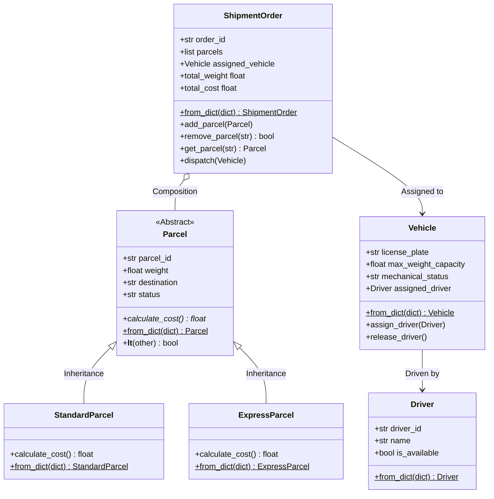

# LogiTrack - מערכת ניהול לוגיסטיקה, שילוח וצי רכב
**הקריה האקדמית אונו · הפקולטה למנהל עסקים ומערכות מידע B.Sc**  
**פרויקט בקורס תכנות מתקדם ב-Python — שלב 1**

---

## 📋 תוכן עניינים
1. [הצעת הפרויקט (תוצר חלק א׳)](#1-הצעת-הפרויקט-תוצר-חלק-א)
2. [מפת הקבצים בפועל](#2-מפת-הקבצים-בפועל)
3. [מודל מונחה עצמים (OOP)](#3-מודל-מונחה-עצמים-oop)
4. [מבני נתונים ועיבוד אוספים](#4-מבני-נתונים-ועיבוד-אוספים)
   - [טבלת מבני הנתונים](#טבלת-מבני-הנתונים)
   - [טבלת פעולות שמשנות אוסף לעומת פעולות שיוצרות אוסף חדש](#טבלת-פעולות-שמשנות-אוסף-לעומת-פעולות-שיוצרות-אוסף-חדש)
5. [מקור הנתונים ותהליך הטעינה (AI Data & Repository)](#5-מקור-הנתונים-ותהליך-הטעינה)
6. [איטרטורים, גנרטורים וצינור עיבוד עצל (Iterators & Lazy Pipeline)](#6-איטרטורים-גנרטורים-וצינור-עיבוד-עצל)
7. [ניהול משאבים בטוח (Context Manager & Transaction Rollback)](#7-ניהול-משאבים-בטוח-context-manager)
8. [דרישות מערכת והוראות הרצה מלאות](#8-דרישות-מערכת-והוראות-הרצה-מלאות)

---

## 1. הצעת הפרויקט (תוצר חלק א׳)

### 1. שם הפרויקט ותיאור המערכת במשפט אחד
**LogiTrack:** מערכת Backend מתקדמת בשפת Python לניהול מחזור חיי חבילות, תעדוף משלוחים לפי רמות שירות (SLA), ושיבוץ טרנזקציוני בטוח של צי רכבי הפצה.

### 2. הצורך העסקי והבעיה שהמערכת פותרת
חברות שילוח ולוגיסטיקה נדרשות להתמודד יום-יום עם עומסי משלוחים משתנים, צווארי בקבוק במיון, ואי-עמידה בזמני אספקה מובטחים עבור חבילות אקספרס. במקביל, ניהול ידני גורר שיבוץ נהגים לרכבים המצויים בטיפול מכני או בהשבתה, חריגה ממשקל העמסה מקסימלי המותר בחוק (סיכון בטיחותי וקנסות), ותת-ניצול של כושר הנשיאה של הצי. המערכת מייעלת וממכנת את התהליך, מונעת שגיאות אנוש, ומבטיחה שיבוץ רכבים כשירים בלבד.

### 3. המשתמשים המרכזיים ותפקידו של כל אחד
- **עובד מחסן / סדרן הפצה (Warehouse Worker):** קולט חבילות חדשות, מאמת משקל ויעד, מעדכן סטטוס חבילה, ומאגד חבילות להזמנת משלוח כוללת.
- **מנהל צי רכב (Fleet Manager):** עוקב אחר הכשירות המכנית של הרכבים, מעביר רכבים לטיפול תקופתי ("In Maintenance"), ומשבץ נהגים זמינים לרכבים תקינים.
- **מנהל תפעול / אנליסט מערכות (System Administrator / Operations Analyst):** מפיק ומנתח דוחות ניצולת צי, מזהה חריגות תפעוליות, ומקבל החלטות אסטרטגיות לרכש/חכירת רכבים נוספים.

### 4. התהליך העסקי המרכזי
- **אירוע מפעיל (Trigger):** הגעת משלוח חבילות חדש למרכז ההפצה (או טעינת קובץ נתונים יומי).
- **מהלך התהליך:** נתוני החבילות נקלטים ועוברים אימות תקינות (משקל חיובי, מזהה ייחודי); חבילות מתועדפות לתור FIFO או לתור עדיפויות (Priority Queue); המערכת מאתרת רכבים תקינים ונהגים זמינים; נבנית הזמנת משלוח (Shipment Order) ומשובצת לרכב מתאים תוך בדיקה שסך המשקל אינו חורג מקיבולת הרכב. השיבוץ מבוצע תחת Context Manager להבטחת Rollback במקרה של תקלה.
- **התוצאה (Outcome):** המשלוח משובץ ומאושר ליציאה, סטטוס החבילות עודכן ל-"In Transit", זמינות הנהג עודכנה, ומופק דוח ניצולת צי.

### 5. זרימת המידע (Information Flow)
- **מידע נכנס (Inputs):** פרטי חבילה (מזהה, משקל, יעד, סוג שירות, סטטוס), פרטי רכב (מספר רישוי, כושר נשיאה, סטטוס מכני), ופרטי נהג (מזהה, שם, זמינות).
- **גורם יוצר / מעדכן:** עובד המחסן ומנהל הצי מזינים או טוענים את הנתונים מקובצי JSONL, והמערכת מעדכנת את מצב הישויות אוטומטית.
- **מידע מופק (Outputs):** הזמנות משלוח מרוכזות עם סיכומי משקל ועלות כוללת, סינון עצל של רכבים פנויים, ודוח ניצולת צי המציג שיעור ניצולת באחוזים והמלצה ניהולית אסטרטגית.

### 6. הערך העסקי הצפוי
- **חיסכון בזמן:** ביטול חישובים ידניים של עומסי משקל ועלויות משלוח.
- **צמצום טעויות אנוש:** מניעת העמסת יתר על רכבים ומניעת יציאת רכב בלתי-תקין לכביש.
- **עמידה בהתחייבויות SLA:** חבילות אקספרס מועמסות ראשונות באמצעות תור עדיפויות מבוסס ערימה (`heapq`).
- **תמיכה מבוססת נתונים בהחלטות הנהלה:** אופטימיזציה של גודל צי הרכב וזיהוי צווארי בקבוק בתחזוקה.

### 7. הישויות המרכזיות והקשרים ביניהן
- **Parcel (מחלקת בסיס אבסטרקטית):** מגדירה מאפיינים משותפים וחוזה חישוב עלות (`calculate_cost`).
  - **StandardParcel:** מחלקת יורשת המממשת תעריף משקל רגיל.
  - **ExpressParcel:** מחלקת יורשת המממשת היטל דחיפות קבוע.
- **Driver:** מייצגת נהג וזמינותו.
- **Vehicle:** מייצגת רכב, כושר נשיאה, כשירות מכנית, ושיבוץ נהג.
- **ShipmentOrder (קשר הרכבה - Composition):** מכילה אוסף חבילות ומקושרת לרכב משלוח.

### 8. שני תרחישי שימוש מרכזיים והחלטות נתמכות
1. **ניהול עומסי שיא ובידול רמות שירות (Peak Load & Express SLA):** בשעות הבוקר מגיעות עשרות חבילות; המערכת שולפת ראשונות את חבילות האקספרס באמצעות `PriorityDispatchQueue` ומקצה אותן לרכב הראשון שיוצא.
2. **שיבוץ צי בטוח וקבלת החלטה אסטרטגית על גודל הצי (Safe Dispatch & Fleet Sizing):** בעת שיבוץ משלוח לרכב, המערכת מוודאת כושר נשיאה וכשירות מכנית. דוח ניצולת הצי מחשב את אחוז הניצולת וממליץ להנהלה האם לרכוש/לחכור רכבים נוספים (אם הניצולת מעל 85%) או לטפל במוסך (אם שיעור ההשבתה מעל 30%).

### 9. רעיון להרחבת המערכת בשלבים עתידיים
חיבור ל-API חיצוני של שירות מפות (כגון Google Maps או OpenStreetMap) לצורך חישוב מרחקי נסיעה אמיתיים, פתרון בעיית סוכן המכירות (TSP) לאופטימיזציית מסלול, הפקת זמני הגעה משוערכים (ETA) בזמן אמת, והרחבה לתמיכה בקריאות רשת מקביליות (Async / Threading).

---

## 2. מפת הקבצים בפועל

המבנה ההנדסי של הפרויקט מחולק למודולים בעלי אחריות מוגדרת (Separation of Concerns), ללא ספריות חיצוניות (Standard Library בלבד):

```text
LogisticProj/
├── logitrack/                       # חבילת הקוד הראשית (Package)
│   ├── __init__.py                  # הגדרת החבילה וחשיפת ה-API הציבורי
│   ├── models.py                    # מחלקות עסקיות, הרכבה, ירושה, פולימורפיזם, ולידציה ו-ABC
│   ├── repository.py                # טעינה עצלה מקובץ נתונים, המרת dict לאובייקטים ואיתור לפי מזהה (find_by_id)
│   ├── processing.py                # עיבוד אוספים, Comprehensions, מיונים, תור FIFO, ערימת עדיפויות ודוחות
│   ├── iterators.py                 # Iterable, Iterator, Generators ו-Pipeline עצל רב-שלבי
│   └── context_managers.py          # Context Manager מותאם אישית עם מנגנון Rollback טרנזקציוני
├── project_name/                    # שכבת תאימות (Alias) לייבוא תחת שם התבנית project_name.*
│   ├── __init__.py
│   ├── models.py
│   ├── repository.py
│   ├── processing.py
│   ├── iterators.py
│   └── context_managers.py
├── data/
│   ├── sample_data.jsonl            # 18 רשומות סינתטיות שנוצרו ב-AI (JSON אחד בכל שורה)
│   └── vehicles_data.jsonl          # נתוני צי רכבים לבדיקות ודוחות ניהוליים
├── main.py                          # תרחיש ההדגמה המלא בלבד (ללא הגדרת מחלקות עסקיות בתוכו)
├── README.md                        # תיעוד הפרויקט, הישויות, החלטות התכנון והוראות ההרצה
├── PROJECT_PROPOSAL.md              # קובץ הצעת הפרויקט (חלק א׳) להגשה ואישור בנפרד
├── AI_USAGE.md                      # פירוט כלי ה-AI, הפניות (Prompts), הבדיקות והתיקונים שבוצעו
├── .gitignore                       # התעלמות מ-venv, pycache, סביבות פיתוח וקבצי מערכת
└── pyproject.toml                   # הגדרות פרויקט תקניות (PEP 517/621)
```

---

## 3. מודל מונחה עצמים (OOP)



### עקרונות התכנון שיושמו:
1. **הרכבה (Composition):** המחלקה `ShipmentOrder` מכילה רשימה של אובייקטי `Parcel`. המחלקה מספקת פעולות ניהול אוסף: הוספה (`add_parcel`), הסרה (`remove_parcel`), איתור (`get_parcel`), שינוי מצב כולל (`dispatch`), וחישוב נתונים מסכמים (`total_weight`, `total_cost`).
2. **הורשה (Inheritance):** המחלקות `StandardParcel` ו-`ExpressParcel` יורשות ממחלקת הבסיס `Parcel`, חולקות את שדות הליבה (מזהה, משקל, יעד, סטטוס) ובדיקות הוולידציה.
3. **פולימורפיזם (Polymorphism):** מתודת `calculate_cost()` מוגדרת במחלקת הבסיס ומוממשת באופן שונה בכל מחלקה יורשת (עלות לפי משקל בחבילה רגילה, תוספת 50 ש"ח קבועה באקספרס). מחלקת `ShipmentOrder` קוראת למתודה זו בלולאה על כל החבילות ללא בדיקת סוג האובייקט (`if/elif`), ובכך מתממש פולימורפיזם טהור.
4. **מחלקה אבסטרקטית (ABC):** `Parcel` יורשת מ-`abc.ABC` ומגדירה `@abstractmethod def calculate_cost`. לא ניתן ליצור מופע ישיר של `Parcel`, אלא רק דרך המחלקות הקונקרטיות היורשות.
5. **כימוס ואימות נתונים (Encapsulation & Validation):**
   - משקל חבילה (`Parcel.weight`) וכושר נשיאה (`Vehicle.max_weight_capacity`) נאכפים באמצעות `@property` ו-`@setter` הדורשים ערך מספרי חיובי ממש (`> 0`), אחרת נזרקת שגיאת `ValueError`.
   - סטטוס חבילה (`Parcel.status`) וסטטוס מכני (`Vehicle.mechanical_status`) נבדקים מול רשימת ערכים חוקיים סגורה.
6. **כלים נוספים מהחומר:**
   - בנאים חלופיים באמצעות `@classmethod from_dict` בכל המחלקות (`Driver`, `Vehicle`, `Parcel`, `StandardParcel`, `ExpressParcel`, `ShipmentOrder`).
   - מתודות קסם: `__len__` (כמות חבילות בהזמנה), `__eq__` (השוואת חבילות לפי מזהה), ו-`__lt__` (השוואת חבילות לפי משקל לצורך תעדוף ישיר במבני נתונים ממוינים ובערימות).

---

## 4. מבני נתונים ועיבוד אוספים

### טבלת מבני הנתונים
| צורך במערכת | מבנה שנבחר | מדוע הוא מתאים |
|---|---|---|
| שמירת רשימת החבילות בהזמנת משלוח | `list` | אוסף מסודר, דינמי וניתן לשינוי (Mutable), המאפשר הוספה והסרה של פריטים וגישה לפי אינדקס. |
| פריקת זוג חבילות דחופות ראשונות ואיסוף השאר | `tuple` + `*` (Unpacking) | מבנה קבוע (Immutable) וחסכוני בזיכרון המבטיח שלמות נתונים של צמד החבילות הקריטיות. |
| מעקב אחר רשימת יעדי החלוקה היומיים | `set` | מונע כפילויות באופן מובנה, ומאפשר פעולות קבוצתיות מהירות (בדיקת שייכות `in` ב-$O(1)$, איחוד `union`, וחיתוך `intersection` עם אזורים מוגבלים). |
| איתור חבילה מהיר לפי מזהה ייחודי | `dict` (Key: ID) | גישה ושליפה מיידית בזמן של $O(1)$, תוך מניעת מזהים כפולים. |
| קיבוץ וספירת חבילות לפי סטטוס | `dict` (Key: Status, Val: Count) | מיפוי קטגוריאלי גמיש המאפשר צבירת כמויות באמצעות מתודת `.get()` עם ערך ברירת מחדל. |
| תור קליטה וטיפול בחבילות רגילות | `collections.deque` (FIFO Queue) | תור יעיל דו-כיווני המאפשר הכנסה לסוף (`append`) ושליפה מהראש (`popleft`) בזמן $O(1)$, תוך שמירה על סדר הגעה הוגן. |
| תור שיבוץ מהיר לחבילות אקספרס ודחופות | `heapq` (Priority Queue) | ערימת מינימום בינארית המאפשרת שליפת הפריט הדחוף ביותר בזמן $O(\log n)$, תוך שילוב מונה שובר שוויון ומתודת `__lt__`. |

### טבלת פעולות שמשנות אוסף לעומת פעולות שיוצרות אוסף חדש
| מבנה נתונים | פעולות שמשנות את האוסף הקיים (In-Place / Mutating) | פעולות שיוצרות ומחזירות אוסף חדש (Non-Mutating) |
|---|---|---|
| `list` | `append(item)`, `remove(item)`, `sort()`, `pop()` | `sorted(list)`, `list1 + list2`, List Comprehension `[x for x in list]`, Slicing `list[:]` |
| `set` | `add(item)`, `discard(item)`, `remove(item)`, `update()` | `union()`, `intersection()`, `difference()`, Set Comprehension `{x for x in list}` |
| `dict` | `dict[k] = v`, `update()`, `pop(k)`, `clear()` | `dict1 \| dict2`, Dict Comprehension `{k: v for ...}`, `copy()` |
| `deque` | `append(item)`, `popleft()`, `appendleft(item)` | יצירת עותק או המרה לרשימה `list(queue)` |
| `heapq` | `heappush(heap, item)`, `heappop(heap)` | יצירת ערימה חדשה מתוך אוסף קיים `heapq.nlargest()`, `sorted(heap)` |

---

## 5. מקור הנתונים ותהליך הטעינה

1. **מקור הנתונים הסינתטיים (AI Generation):**  
   קובץ הנתונים `data/sample_data.jsonl` נוצר בעזרת מודל AI בהתאם להנחיות קפדניות: 18 רשומות, אובייקט JSON תקני אחד בכל שורה (ללא עטיפת מערך חיצונית), ללא שמות ומידע אישי אמיתי, עם פיזור ערכים ריאלי (ערים בישראל, משקלים שבין 0.5 ל-15.0 ק"ג, שילוב סוגי standard ו-express, וסטטוסים שונים).
2. **תהליך הטעינה העצל ב-`ParcelRepository`:**  
   - הקובץ נקרא שורה אחר שורה בתוך בלוק `with open(..., mode="r", encoding="utf-8")`.
   - **אין שימוש ב-`read()` או ב-`readlines()`** כדי למנוע העמסת קובצי ענק לזיכרון בבת אחת.
   - כל שורה מומרת למילון באמצעות `json.loads(line)`.
   - מתבצע אימות שלמות: בדיקת קיום מזהה, אימות מזהה ייחודי באמצעות מעקב ב-`seen_ids = set()`, ובדיקת תקינות משקל (`weight > 0`).
   - המילון מומר למופע קונקרטי של `Parcel` באמצעות הבנאי האלטרנטיבי `Parcel.from_dict(data)`.
   - הפונקציה מחזירה כל אובייקט באמצעות `yield`, ובכך מתפקדת כגנרטור עצל אמיתי.
3. **איתור לפי מזהה (`find_by_id`):**  
   מתודת `find_by_id(parcel_id)` סורקת את הקובץ באופן עצל ועוצרת מיד עם מציאת הרשומה המבוקשת מבלי לקרוא את יתרת הקובץ. אם המזהה אינו קיים, מוחזר `None`.

---

## 6. איטרטורים, גנרטורים וצינור עיבוד עצל

### מימוש Iterable ו-Iterator מותאמים אישית
- **מחלקת האוסף `ParcelCollection` (Iterable):** שומרת את אוסף החבילות ומממשת את מתודת `__iter__()`. כל קריאה ל-`iter(collection)` יוצרת ומחזירה מופע חדש ועצמאי של `ParcelIterator`.
- **מחלקת המעבר `ParcelIterator` (Iterator):** מנהלת מצב ריצה פנימי (`_index`). מממשת את `__iter__()` (המחזירה את עצמה) ואת `__next__()` השולפת את האיבר הבא. בהגעה לסוף הרשימה נזרקת חריגת `StopIteration`.
- **הדגמת עצמאות ב-main.py:** נוצרים שני איטרטורים שונים (`it1` ו-`it2`) על אותו אוסף בדיוק. קידום של `it1` אינו משפיע על המיקום של `it2`, מה שמוכיח הפרדה מוחלטת בין שמירת הנתונים לבין ניהול מצב המעבר.

### Generator עם `yield`
הפונקציה `filter_active_vehicles(vehicles)` היא פונקציית Generator המסננת ומחזירה רק רכבים בעלי כשירות מכנית תקינה (`mechanical_status == "OK"`).  
ב-`main.py` מודגמים שלבי מחזור החיים:
1. יצירת אובייקט הגנרטור מבלי לעבד מראש את כל הרשימה.
2. שליפת האיבר הראשון באמצעות קריאה בודדת ל-`next(gen)`.
3. המשך המעבר בלולאת `for` החל מהנקודה המדויקת בה עצר הגנרטור.
4. אימות מיצוי (Exhaustion): הוכחה שלאחר סיום הגנרטור לא ניתן לעבור עליו שוב ללא יצירת מופע חדש.

### Generator Expression וצינור עיבוד עצל (Lazy Pipeline)
הפונקציה `build_available_fleet_pipeline` בונה צינור רב-שלבי לסינון ומיפוי צי הרכבים:
- **שלב 1 (סינון תקינות):** `stage_1_ok = (v for v in vehicles if v.mechanical_status == "OK")`
- **שלב 2 (סינון זמינות):** `stage_2_unassigned = (v for v in stage_1_ok if v.assigned_driver is None)`
- **שלב 3 (מיפוי מסכם):** `stage_3_summary = ({"license_plate": v.license_plate, "available_capacity_kg": v.max_weight_capacity} for v in stage_2_unassigned)`

#### תשובות ל-4 שאלות המחוון:
1. **מה גורם ל-Pipeline להתחיל לעבוד?**  
   ה-Pipeline אינו מבצע שום חישוב בעת הגדרתו. הוא מתחיל לעבוד אך ורק כאשר גורם חיצוני מושך ממנו נתון (Demand-Driven Evaluation), באמצעות קריאה ל-`next()` או לולאת `for`.
2. **אילו פריטים לא היה צורך לעבד לאחר העצירה?**  
   בהתאם להנחיית הרובריקה ("צרכו רק את שתי התוצאות הראשונות ועצרו"), נשלפו בדיוק שני רכבים באמצעות `next()`. כל יתר הרכבים בצי (רכבים 3, 4 ו-5) מעולם לא נבדקו בשלבים 2 ו-3, ופעולת המיפוי שלהם נחסכה לחלוטין.
3. **מה ההבדל בין List Comprehension לבין Generator Expression במקרה שלנו?**  
   לו היינו משתמשים ב-List Comprehension, בכל שלב הייתה נבנית רשימת ביניים שלמה בזיכרון ה-RAM עבור כל צי הרכבים עוד לפני שליפת האיבר הראשון. לעומת זאת, Generator Expression מייצר פריט אחד בלבד בכל פעם, ישירות מהמקור לצרכן ללא רשימות ביניים.
4. **מדוע יש ליצור Generator חדש כדי לבצע מעבר נוסף מההתחלה?**  
   גנרטור הוא חד-פעמי (One-Way Stream). המצב הפנימי שלו מתקדם בלבד, וכאשר הוא מגיע לסיום ונזרקת חריגת `StopIteration`, הוא מתרוקן ולא ניתן לאפס את המצביע הפנימי שלו. כדי להתחיל מעבר חדש, יש להפעיל את פונקציית הגנרטור מחדש.

---

## 7. ניהול משאבים בטוח (Context Manager)

### מחלקת `FleetDispatchSession`
המחלקה מממשת Context Manager לשליטה בטרנזקציית שיבוץ נהג לרכב הפצה:
- **בכניסה לבלוק (`__enter__`):** שומרת עותק של המצב המקורי של הרכב (`assigned_driver`) והנהג (`is_available`), משבצת את הנהג לרכב, ומסמנת את הנהג כלא-זמין. מחזירה את מופע הרכב המשובץ לשימוש בתוך בלוק ה-`with ... as vehicle`.
- **ביציאה מהבלוק (`__exit__`):**
  - **במצב תקין (`exc_type is None`):** השיבוץ מאושר ומקובע (Commit).
  - **במקרה של שגיאה (`exc_type is not None`):** מתבצע **Rollback** אוטומטי המבטל את השיבוץ ומשחזר את זמינות הנהג והרכב למצבם המקורי לפני תחילת הטרנזקציה.
- **הפצת החריגה:** המתודה מחזירה `False`, כדי לוודא שהשגיאה תמשיך לצוף במעלה מחסנית הקריאות ולא תיבלע בשקט.

---

## 8. דרישות מערכת והוראות הרצה מלאות

### גרסת Python נדרשת
- **Python 3.10 ומעלה** (המערכת פותחה ונבדקה בהצלחה מלאה על Python 3.14).
- **תלויות חיצוניות:** 0 ספריות צד-שלישי. הפרויקט כולו נשען אך ורק על ספריית ה-Standard Library המובנית של פייתון (`json`, `abc`, `heapq`, `collections`, `pathlib`, `typing`).

### פקודת ההרצה
משורת הפקודה, מתיקיית השורש של הפרויקט:
```bash
python3 main.py
```
או באמצעות הסביבה הווירטואלית המקומית:
```bash
.venv/bin/python main.py
```

### פלט הרצה לדוגמה מ-`main.py`
ההרצה מציגה באופן קריא ומובנה את כל 6 חלקי המערכת:
1. טעינת 18 רשומות עצלה מ-JSONL וחיפוש מזהה קיים מול מזהה חסר.
2. יצירת ישויות, לכידת שגיאת ולידציה (קיבולת שלילית), והדגמת פולימורפיזם בחישוב עלות.
3. שני איטרטורים עצמאיים, מחזור חיים של גנרטור (next, for, מיצוי), וצריכת 2 איברים בלבד מ-Pipeline עצל.
4. פריקת טאפל, פעולות קבוצות, comprehensions, מיון מרובה שדות, ותור עדיפויות מול תור FIFO.
5. שיבוץ מוצלח מול שיבוץ שנכשל בטרנזקציה עם אימות Rollback מלא.
6. יציאת משלוח לדרך והפקת דוח ניצולת צי אסטרטגי להנהלה.
